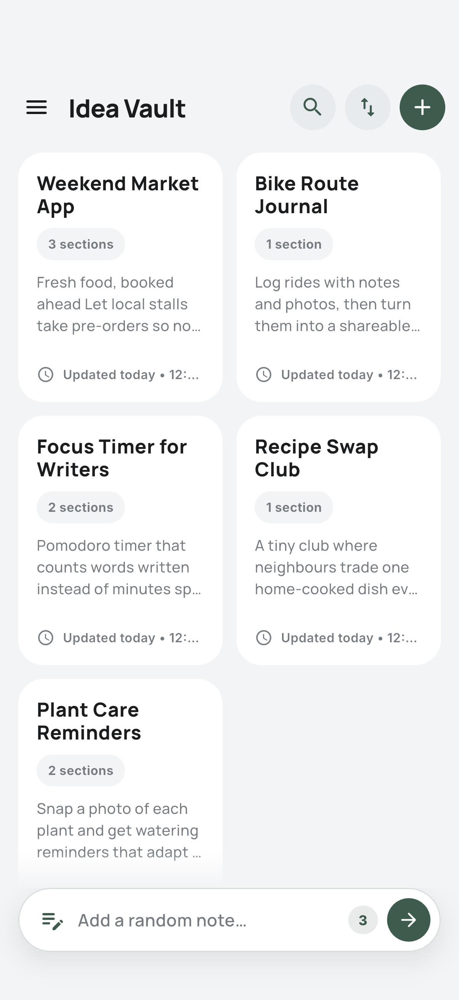
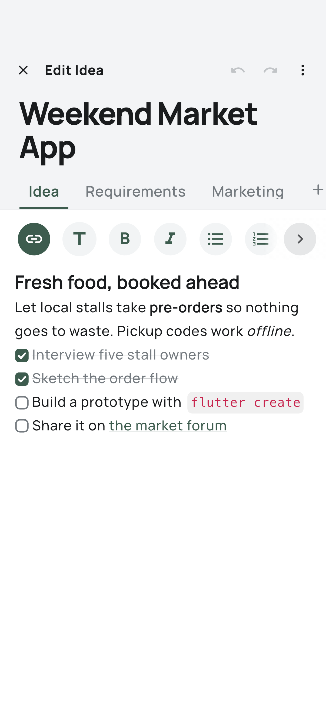
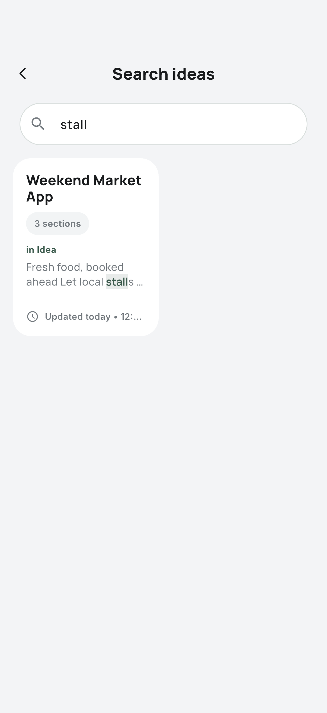
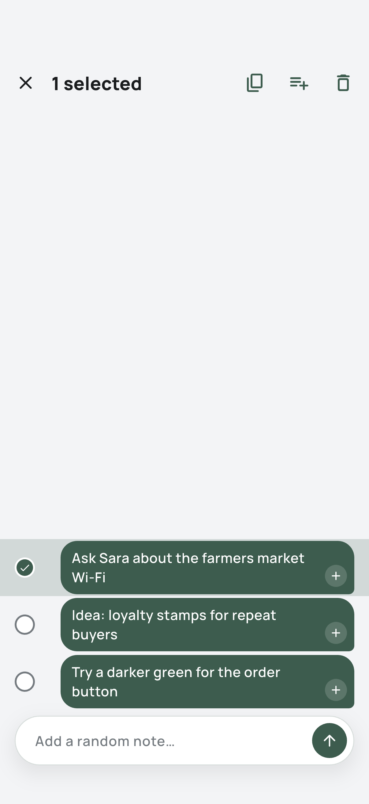
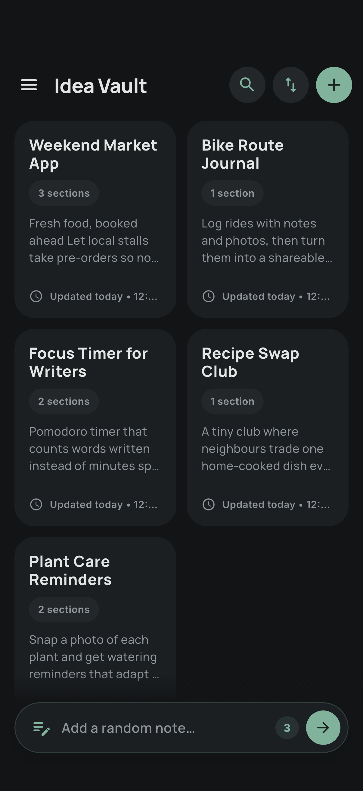
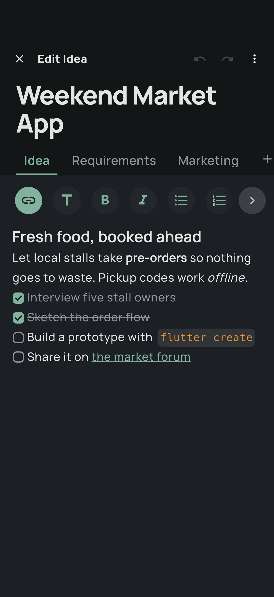
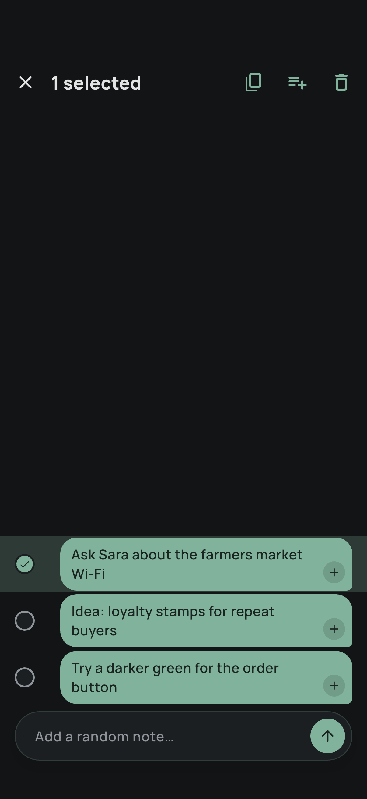

# Idea Vault

A calm, private place to capture ideas and grow them into plans. Built with Flutter for Android and iOS.

<a href="https://play.google.com/store/apps/details?id=com.pocketmicros.ideavault">Google Play</a> · <a href="https://apps.apple.com/app/id6765999984">App Store</a>

## Screenshots

| Home | Editor | Search | Random Notes |
|:---:|:---:|:---:|:---:|
|  |  |  |  |
|  |  |  |  |

## Features

- **Ideas with sections**: split each idea into parts like requirements, design or marketing.
- **Formatting that just works**: headings, bold, italic, lists, checklists, code and links, with no symbols to learn.
- **Random Notes**: jot down a quick thought now and file it into an idea later.
- **Search everything**: finds words in any section and shows where they matched.
- **Locked notes**: protected with a PIN or biometrics, and encrypted on the device and in backups.
- **Cloud backup**: Google Drive on Android and iCloud on iOS, with history and safe restore.
- **Export**: share an idea as a PDF or copy it for an AI chat.
- **Light and dark themes**.

## Getting started

You need the stable Flutter SDK (3.38 or newer) and Xcode or Android Studio.

1. Clone the repository.
2. Copy `.env.example` to `.env`. Set `DEBUG=true` for development.
3. Run `flutter pub get`, then `flutter run`.

The app runs without any cloud setup. To use cloud backup, follow [Cloud backup setup](docs/CLOUD_BACKUP_SETUP.md).

## Documentation

- [Changelog](CHANGELOG.md)
- [Cloud backup setup](docs/CLOUD_BACKUP_SETUP.md)
- [App flow rules](docs/FLOW_RULES.md)
- [Local database](docs/LOCAL_DB_STRUCTURE.md)
- [Audit](docs/AUDIT.md) and [improvement plan](docs/PLAN.md)

## Contributing

Issues and pull requests are welcome. Please run `flutter analyze` and `flutter test` before opening a pull request.

To refresh the screenshots, start an iOS simulator and run:

```
flutter drive --driver=test_driver/integration_test.dart --target=integration_test/screenshots_test.dart
```
